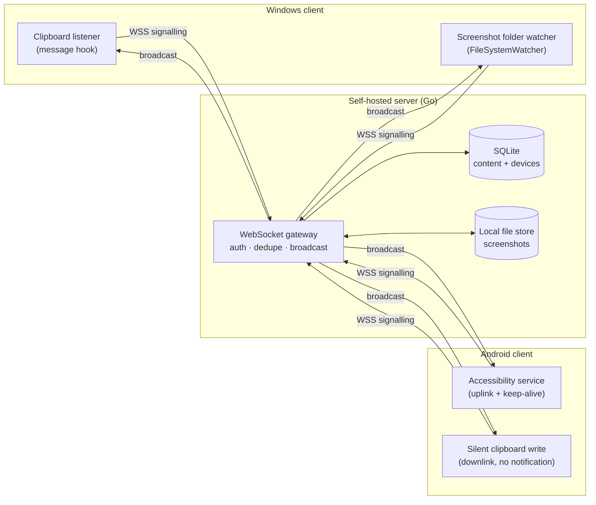
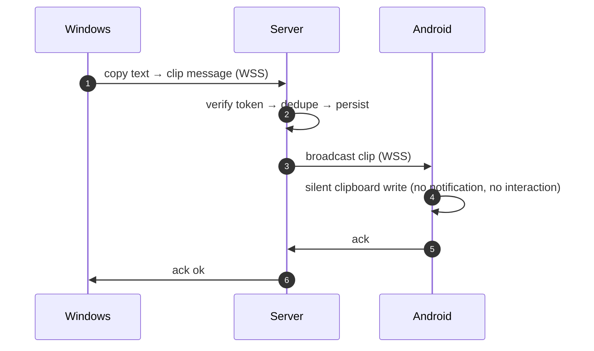
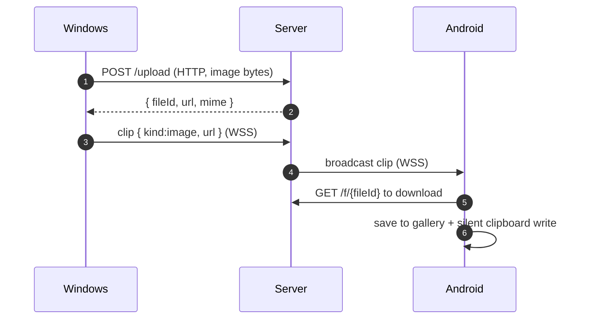

> [!IMPORTANT]
> **This project was generated by AI.**

# ClipBridge

**Cross-device clipboard & screenshot sync — self-hosted, your data stays yours.**

Copy text or take a screenshot on any device, and it shows up **automatically and instantly** on all your other paired devices — desktop, phone, tablet. No "send" button, ever.

<div align="center">

**Go + WebSocket + SQLite** · **C# / .NET 8** · **Kotlin / Compose**

**Current version v0.9.9** — [What's new](CHANGELOG.md) · [Downloads](../../releases/latest)

**English** | [中文](README.md)

</div>

---

## Table of contents

- [Quick start](#quick-start) — one `docker run` and you're up
  - [Server](#server) · [Clients](#clients)
- [Why ClipBridge](#why-clipbridge) — what problem it solves
- [How it works](#how-it-works) — architecture and design decisions
- [Features](#features) · [Platform support](#platform-support)
- [Version and downloads](#version-and-downloads) · [Changelog](CHANGELOG.md)
- [Repository layout](#repository-layout) · [Documentation](#documentation)
- [Security notes](#security-notes) · [License](#license)

---

## Quick start

### Server

The image is published on GHCR (**public, no login needed**, `amd64` + `arm64`) —
**no need to clone the repo or build anything locally**, just pull and run.

These are the settings you need:

| Variable | What to put |
| --- | --- |
| `CLIPBRIDGE_SERVER_NAME` | your domain, e.g. `nas.example.com` |
| `CLIPBRIDGE_PUBLIC_BASE_URL` | `https://nas.example.com:8443` — port must match `-p` |
| `CLIPBRIDGE_JWT_SECRET` | a random string (**how to generate: see below**) |
| `CLIPBRIDGE_ACME_DOMAIN` | your domain (used to obtain the certificate) |
| `CLIPBRIDGE_ACME_EMAIL` | your email |
| `CF_Token` | Cloudflare API token (**how to get: see below**) |
| `CLIPBRIDGE_PAIR_CODE` | an 8-digit number you pick; every device enters it when pairing |

**`CLIPBRIDGE_JWT_SECRET`** signs the login tokens — any random string works, but **pick it once and never change it**, or every paired device gets logged out and has to pair again. To generate one, open a terminal (Windows: search "PowerShell" in the Start menu; macOS: search "Terminal"; NAS: SSH in) and run the line for your OS — you'll get a 64-character string:

- macOS / Linux / NAS → `openssl rand -hex 32`
- Windows PowerShell → `-join ((1..64) | ForEach-Object { '{0:x}' -f (Get-Random -Maximum 16) })`

**`CF_Token`** (used to obtain the TLS certificate automatically):

1. Log in to Cloudflare → avatar (top right) → "My Profile" → "API Tokens"
2. "Create Token" → pick the "Edit zone DNS" template
3. Under Zone Resources select your own domain → create → copy the token

> Using another DNS provider (Aliyun, Tencent Cloud, ...)? Pass `CLIPBRIDGE_ACME_DNS=dns_ali` (or `dns_dp`) and use that provider's credential variable instead.

**You can run without the three certificate settings** — but then it serves plain HTTP only, and Android 9+ refuses cleartext, so phones can't connect.

There are two ways to pass the config in. **The first is recommended:**

#### Option 1 (recommended)

Replace the domain and every `CHANGE_ME` with your own values, then run the whole thing:

```bash
docker run -d --name clipbridge \
  --restart unless-stopped \
  -p 8443:8443 \
  -e CLIPBRIDGE_SERVER_NAME=nas.example.com \
  -e CLIPBRIDGE_PUBLIC_BASE_URL=https://nas.example.com:8443 \
  -e CLIPBRIDGE_JWT_SECRET=CHANGE_ME \
  -e CLIPBRIDGE_ACME_DOMAIN=nas.example.com \
  -e CLIPBRIDGE_ACME_EMAIL=you@example.com \
  -e CF_Token=CHANGE_ME \
  -e CLIPBRIDGE_PAIR_CODE=CHANGE_ME \
  -v clipbridge-data:/var/lib/clipbridge \
  ghcr.io/hemuxd/clipbridge:0.9.9

docker logs -f clipbridge     # the pair code is printed here (all devices can share it)
```

#### Option 2: keep it in a file, use `--env-file`

If the command above feels too long, or you want the config on disk, save it as `clipbridge.env`:

```ini
# your domain (replace it everywhere below)
CLIPBRIDGE_SERVER_NAME=nas.example.com
CLIPBRIDGE_PUBLIC_BASE_URL=https://nas.example.com:8443

# random secret (see above), pick once and don't change
CLIPBRIDGE_JWT_SECRET=CHANGE_ME

# for the certificate
CLIPBRIDGE_ACME_DOMAIN=nas.example.com
CLIPBRIDGE_ACME_EMAIL=you@example.com
CF_Token=CHANGE_ME

# an 8-digit number you pick
CLIPBRIDGE_PAIR_CODE=CHANGE_ME
```

```bash
docker run -d --name clipbridge \
  --restart unless-stopped \
  -p 8443:8443 \
  --env-file clipbridge.env \
  -v clipbridge-data:/var/lib/clipbridge \
  ghcr.io/hemuxd/clipbridge:0.9.9
```

> `#` comments need Docker 25+; on older versions strip the comment lines before using `--env-file`.
> This file holds secrets — **don't commit it**.

The image bundles the **Go binary** and **Nginx** — one container, no extra dependencies.

**Port**: home ISPs often block 80/443, so the default public port is **8443**. If you change it, update both `-p` and the port inside `CLIPBRIDGE_PUBLIC_BASE_URL` — the latter is the prefix for image URLs, so a mismatch breaks image delivery.

**Switching versions**: just change the image tag `0.9.9` (GHCR currently carries `0.9.9` and `sha-<commit>` tags).

**Alternative certificate setup**: if you already have a certificate signed on the host with acme.sh, you can skip the built-in ACME — add a mount to the `docker run` command above and drop the three ACME settings:

```bash
-v /path/to/certs:/certs:ro     # the container reads /certs/fullchain.pem and /certs/privkey.pem
```

After a renewal, reload nginx: `docker exec clipbridge nginx -s reload`
(don't use `docker restart` — it drops existing connections).

> **Why in-container ACME forces IPv4** (`CLIPBRIDGE_ACME_IPV4_ONLY=1`): the default Docker bridge has no IPv6 egress, so the container resolves AAAA records, tries IPv6 and hangs until timeout; acme.sh sets **no response timeout on POST requests**, so a single dropped packet stalls it forever (we measured the `finalize` step hanging for minutes; forcing IPv4 made 5 consecutive runs succeed). Only set it to 0 if you know your IPv6 is more reliable.

> Prefer compose for centralised config? The repo ships compose files under `deploy/docker/` — they pull the same image.

Or run it locally (Go 1.22+):

```bash
cd server
go run ./cmd/clipbridge -config config.example.yaml
```

### Clients

- **Windows**: download `clipbridge-windows-0.9.9-x64.zip` from [Releases](../../releases/latest), unzip and double-click `ClipBridge.exe` (**single file, bundles the .NET 8 runtime** — nothing to install first). On first launch a settings window appears: enter the server URL (`https://nas.example.com:8443`) plus the pair code, and it lives in the tray from then on.
  Build it yourself: `cd clients/windows/src && dotnet publish -c Release -r win-x64 --self-contained true -p:PublishSingleFile=true -p:IncludeNativeLibrariesForSelfExtract=true` — that last flag is what packs the WPF / VC native libraries in, giving you a true single file.
- **Android**: install `clipbridge-android-0.9.9.apk` from [Releases](../../releases/latest); or build with `cd clients/android && gradle assembleDebug` (output in `app/build/outputs/apk/debug/`). Then open the app → enter the server URL (`https://nas.example.com:8443`) → pair → **enable the accessibility service**. Copying and screenshots then sync automatically; screenshot sync needs to be turned on separately in the app and granted photo access.

> Full environment setup, deployment and troubleshooting: see `docs/开发指南.md` (Chinese).

---

## Why ClipBridge

There are plenty of clipboard-sync tools, but most suffer from the same problems: data goes through a third-party server, LAN-only, text-only, or you have to press "send". ClipBridge's stance:

| Goal | How ClipBridge does it |
| --- | --- |
| Privacy | The server is **self-hosted** — content only ever passes through your own machine |
| One channel | Text and screenshots use the **same pipeline** |
| Frictionless | On Windows it's **zero-interaction** — copy and it's already synced |
| Multi-device | Hub-and-spoke fan-out, so N devices sync with each other out of the box |

---

## How it works

### 1. Architecture: hub-and-spoke

Every client holds **a single WebSocket connection to the server**; clients never talk to each other directly. The server does three things: **authenticate → de-duplicate → broadcast**.



### 2. Data flow: text



### 3. Data flow: images

Image bytes **do not go over the WebSocket** — they're uploaded over HTTP first and only the lightweight metadata travels over the socket. This keeps large files from blocking the long-lived connection.



### 4. Loop prevention: where sync tools usually break

Cross-device sync has a classic infinite loop: `A copies → B writes to clipboard → B reports it → A writes → ...`, which can hammer the server within seconds. ClipBridge blocks it with **three layers**:

```
┌─────────────────────────────────────────────────────────┐
│ Layer 1  Client-side HashCache                          │
│   Before writing remote content locally, record its     │
│   hash. When the local listener fires with that hash,   │
│   it's recognised as our own write and skipped.         │
├─────────────────────────────────────────────────────────┤
│ Layer 2  Server-side hash dedupe                        │
│   Same hash already broadcast within the retention      │
│   window → ignored, returns 2003.                       │
├─────────────────────────────────────────────────────────┤
│ Layer 3  msgId idempotency                              │
│   Client resends the same msgId → hits the unique       │
│   constraint, treated as a duplicate.                   │
└─────────────────────────────────────────────────────────┘
```

The critical detail: register the hash **before** writing to the clipboard, not after — otherwise the listener event fires before the hash is queryable and the loop slips through. Both the Windows and Android clients follow this order.

### 5. Android's hard limits and the trade-offs

This is the one constraint the whole project can't design around (see `docs/可行性报告.md`, Chinese):

> Since Android 10, background apps **cannot read the clipboard**, and **no permission can grant it**.
> AOSP `ClipboardService.clipboardAccessAllowed` only allows reads for the app currently holding focus,
> the default IME, SystemUI, ContentCapture services and Autofill services —
> **accessibility services are not on the exemption list**. Writes are unrestricted
> (`OP_WRITE_CLIPBOARD` is allowed outright).

So on Android ClipBridge does this:

| Direction | Approach | Reliability |
| --- | --- | --- |
| Downlink (PC → phone) | Write straight into the system clipboard, silently; images are also saved to the gallery | ✅ High (writes are unrestricted) |
| Uplink (phone → PC) | Accessibility service: try reading the clipboard first; if refused, fall back to the selection text recorded before the copy | ⚠️ Depends on the vendor ROM |
| Uplink fallback | System share sheet → "Share → ClipBridge", zero permissions, zero restrictions | ✅ Always works |

The uplink has two paths because clipboard reads are refused outright (returning null) on many devices — the accessibility events are then the only way to reconstruct what the user copied. **When neither path yields anything, ClipBridge would rather miss a sync than send something the user never copied.**

### 6. Only "this one action" counts

Syncing does not mean "push whatever is in the clipboard" — it means **sync the copy/screenshot you just made**:

- At startup each client records the content already present in the clipboard / screenshot folder as history and never reports it
- The server does **no offline replay** by default (`limits.offline_replay_seconds: 0`): anything queued while a device was offline is dropped rather than flushed on reconnect
- If you want to tolerate a few seconds of network flapping (so content isn't lost in a reconnect gap), set it to 60–120

---

## Features

- ✅ **Real-time, bidirectional** text / image sync
- ✅ Only syncs **the current action** — history is never re-sent (replay window is configurable)
- ✅ Android **silent downlink**: content is written to the clipboard with no "content received" notification
- ✅ Android **background survival**: the connection survives swiping the app away (`stopWithTask=false`), plus boot auto-start and a watchdog
- ✅ Optional end-to-end encryption (AES-256-GCM — the server only relays ciphertext)
- ✅ Regex-based sensitive-content filtering and an app exclusion list
- ✅ History expires automatically (7 days by default)
- ✅ **Single image** deployment: the Go binary and Nginx ship in one container, started with one command
- ✅ SQLite, zero ops, pure-Go driver — statically and cross-compilable
- ✅ Pair code reusable across devices (or set a permanent one) + HMAC token auth + per-device rate limiting

---

## Version and downloads

**Current version v0.9.9** (2026-10-21). Full change history: **[CHANGELOG.md](CHANGELOG.md)** (Chinese).

Artifacts are on the [Releases page](../../releases/latest):

| Artifact | Platform | Notes |
| --- | --- | --- |
| `clipbridge-server-0.9.9-linux-amd64.tar.gz` | Linux x86-64 | static binary + sample config + schema SQL + systemd / nginx files |
| `clipbridge-server-0.9.9-windows-amd64.zip` | Windows x86-64 | same, server binary |
| `clipbridge-server-0.9.9-darwin-arm64.tar.gz` | macOS Apple Silicon | same |
| `clipbridge-android-0.9.9.apk` | Android 8.0+ | client package (debug-signed, installs directly) |
| `clipbridge-windows-0.9.9-x64.zip` | Windows 10/11 x64 | desktop client, unzip and run (single exe, bundles .NET 8) |
| `SHA256SUMS.txt` | — | SHA-256 checksums for the above |

**Docker deployment needs no download** — the image is on GHCR (public, `amd64` + `arm64`): `ghcr.io/hemuxd/clipbridge:0.9.9`. One `docker run` pulls and starts it; see [Quick start](#quick-start) above for the full steps (config, certificates).

---

## Platform support

| Capability | Windows | Android |
| --- | --- | --- |
| Clipboard text listening | ✅ Native system notification, frictionless | ⚠️ Restricted in background; reconstructs via accessibility events |
| Screenshot capture | ✅ Clipboard bitmap + folder watcher | ✅ Watches the gallery for new images (needs photo-read permission, off by default) |
| Clipboard write | ✅ Direct | ✅ Silent (writes aren't restricted in background) |
| Save received images | ✅ To `Pictures\ClipBridge` (can be disabled) | ✅ To gallery `Pictures/ClipBridge` |
| Persistent notification | ✅ None (tray icon) | ⚠️ Background survival needs a silent notification (toggleable in-app); the downlink itself never shows anything |
| Reliability fallback | — | ✅ System share sheet (zero permissions) |

---

## Repository layout

```
clipbridge/
├── server/                 # server (Go)
│   ├── cmd/clipbridge/     # entry point
│   ├── internal/           # config / auth / hub / store / api / model
│   └── migrations/         # schema SQL
├── clients/
│   ├── windows/            # Windows client (C# / .NET 8)
│   └── android/            # Android client (Kotlin / Compose)
├── shared/protocol/        # cross-platform protocol (single source of truth)
├── deploy/
│   ├── docker/             # single-image deployment (Go + Nginx)
│   ├── nginx/              # host Nginx setup (non-Docker)
│   └── systemd/            # boot auto-start
├── docs/                   # feasibility report · dev guide · project status
└── tools/                  # smoke-test scripts
```

---

## Documentation

| Document | Contents |
| --- | --- |
| `docs/可行性报告.md` | technical feasibility, risks, Android permission limits |
| `docs/开发指南.md` | setup, deployment, integration, troubleshooting |
| `docs/项目状态.md` | completeness, known TODOs, design decisions |
| `shared/protocol/PROTOCOL.md` | cross-platform protocol (single source of truth) |

> The docs are currently in Chinese only.

---

## Security notes

- TLS end to end (Android 9+ blocks cleartext HTTP by default)
- Configure a regex blacklist so passwords / verification codes are never synced
- Server-side history can expire automatically, and can be wiped in one action

---

## License

Licensed under **[GNU AGPL-3.0](LICENSE)** — see [LICENSE](LICENSE) for the full text.

You're free to use, modify and distribute it (commercially included), with two obligations:

- **Derivative works must also be released under AGPL-3.0** — you can't close the source;
- **If you run it as a network service, you must offer the source to its users** (AGPL-3.0 section 13) —
  the extra clause GPL doesn't have, closing the "turn it into a hosted service and keep it closed" loophole.

Copyright (C) 2026 HeMuxD
