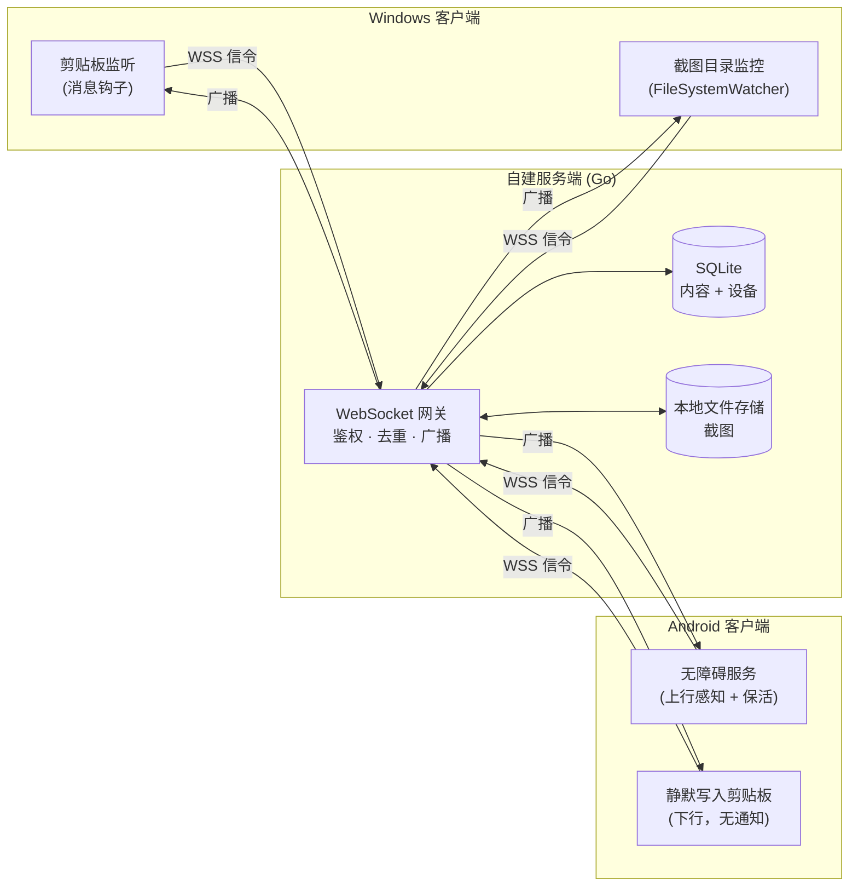
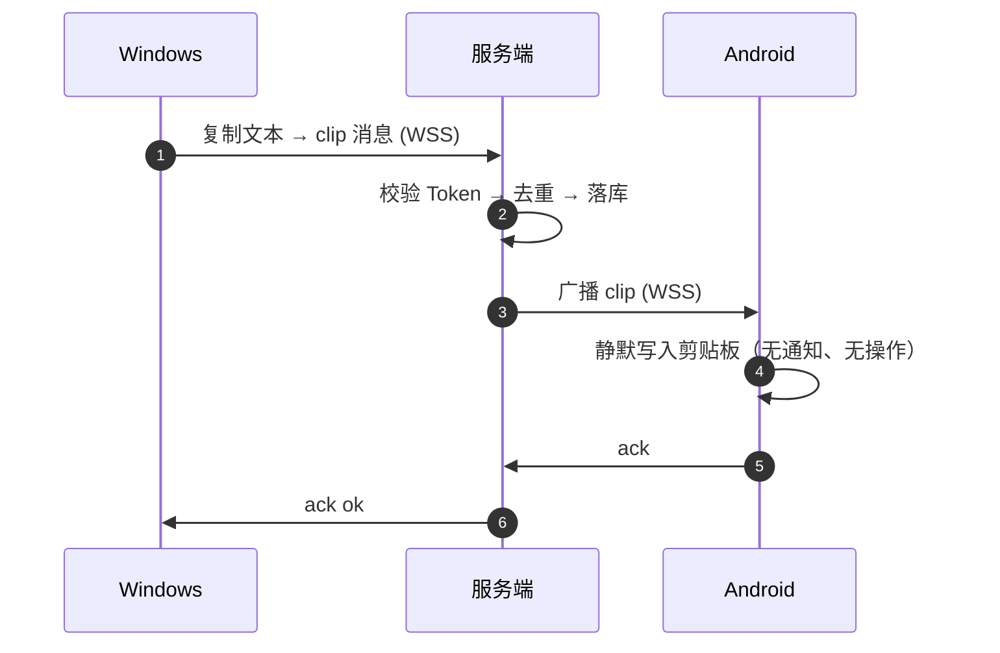
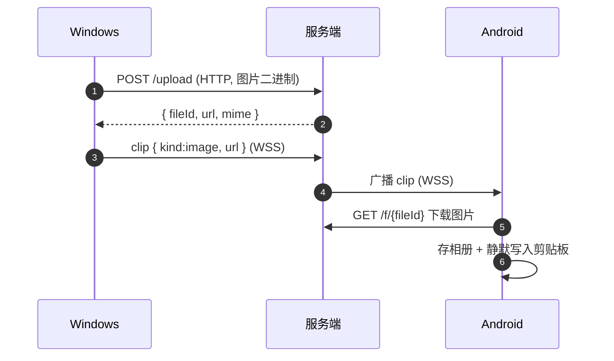

> [!IMPORTANT]
> **本项目由 AI 生成 · This project was generated by AI.**

# ClipBridge

**跨端剪贴板 / 截图同步，自建服务端，数据全掌控。**

在任意一台设备上复制一段文字、截一张图，它都会**自动、实时**出现在你所有其他已配对的设备上 —— 电脑、手机、平板都一样，全程无需手动点击"发送"。

<div align="center">

**Go + WebSocket + SQLite** · **C# / .NET 8** · **Kotlin / Compose**

**当前版本 v0.0.11** — [本版改动](#v0011-改动内容) · [下载产物](../../releases/latest)

</div>

---

## 目录

- [快速开始](#快速开始) —— 一条 `docker run` 就跑起来
  - [服务端](#服务端一条-docker-run) · [客户端](#客户端)
- [为什么需要它](#为什么需要它) —— 它解决什么问题
- [核心原理](#核心原理) —— 怎么工作、为什么这么设计
- [特性](#特性) · [平台能力](#平台能力)
- [版本](#版本) —— 各版本改动记录与产物[下载](#下载)
- [目录结构](#目录结构) · [文档](#文档) · [安全提示](#安全提示)

---

## 快速开始

### 服务端（一条 docker run）

镜像已发布在 GHCR 上（**公开，无需登录**，含 `amd64` + `arm64` 双架构）——
**不用 clone 仓库，也不用本地构建**，拉下来直接跑。

需要设置的配置就下面这几项：

| 变量 | 填什么 |
| --- | --- |
| `CLIPBRIDGE_SERVER_NAME` | 你的域名，如 `nas.example.com` |
| `CLIPBRIDGE_PUBLIC_BASE_URL` | `https://nas.example.com:8443`，端口要和 `-p` 一致 |
| `CLIPBRIDGE_JWT_SECRET` | 一串随机字符（**生成方法见下**） |
| `CLIPBRIDGE_ACME_DOMAIN` | 你的域名（申请证书用） |
| `CLIPBRIDGE_ACME_EMAIL` | 你的邮箱 |
| `CF_Token` | Cloudflare API Token（**获取方法见下**） |
| `CLIPBRIDGE_PAIR_CODE` | 自己定一个 8 位数字，多台设备配对时都填它 |

**签名密钥 `CLIPBRIDGE_JWT_SECRET` 怎么来**：一串随机字符，用来给登录令牌签名。
**定好之后别再改** —— 改了的话，所有已配对的设备都会掉线、需要重新配对。
生成方法：打开终端（Windows 在开始菜单搜「PowerShell」，macOS 搜「终端」，NAS 用 SSH 登录），
执行下面「对应你系统」的那一行，会得到一串 64 位的字符：

- macOS / Linux / NAS → `openssl rand -hex 32`
- Windows PowerShell → `-join ((1..64) | ForEach-Object { '{0:x}' -f (Get-Random -Maximum 16) })`

**Cloudflare Token `CF_Token` 怎么来**（用来自动申请证书）：

1. 登录 Cloudflare → 右上角头像 →「我的个人资料」→「API 令牌」
2.「创建令牌」→ 选「编辑区域 DNS」(Edit zone DNS) 这个模板
3. 区域资源选你自己的域名 → 创建 → 复制生成的那串令牌

> 换用阿里云 / 腾讯云等其它 DNS 的话，改传 `CLIPBRIDGE_ACME_DNS=dns_ali`（或 `dns_dp`），
> 并改用该服务商的凭据变量名。

**证书这三项都不填也能跑**，但只有明文 HTTP —— 而 Android 9+ 默认拒绝明文，手机端连不上。

把配置传进去有两种方式，**推荐第一种**：

#### 方式一（推荐）：

把下面命令里的域名和 `CHANGE_ME` 换成你自己的值，整条复制执行：

```bash
docker run -d --name clipbridge \
  --restart unless-stopped \
  -p 8443:8443 \
  -e CLIPBRIDGE_SERVER_NAME=nas.example.com \
  -e CLIPBRIDGE_PUBLIC_BASE_URL=https://nas.example.com:8443 \
  -e CLIPBRIDGE_JWT_SECRET=CHANGE_ME \
  -e CLIPBRIDGE_ACME_DOMAIN=nas.example.com \
  -e CLIPBRIDGE_ACME_EMAIL=you@example.com \
  -e CF_Token=CHANGE_ME \
  -e CLIPBRIDGE_PAIR_CODE=CHANGE_ME \
  -v clipbridge-data:/var/lib/clipbridge \
  ghcr.io/hemuxd/clipbridge:0.0.11

docker logs -f clipbridge     # 配对码打印在这里（多台设备可复用同一个）
```

#### 方式二：写进文件，用 `--env-file`

嫌上面那条命令太长、或想把配置留档复用，就存成一个 `clipbridge.env`：

```ini
# 你的域名（下面几处都换成它）
CLIPBRIDGE_SERVER_NAME=nas.example.com
CLIPBRIDGE_PUBLIC_BASE_URL=https://nas.example.com:8443

# 随机密钥（生成方法见上面的表格说明），定好后别改
CLIPBRIDGE_JWT_SECRET=CHANGE_ME

# 申请证书用
CLIPBRIDGE_ACME_DOMAIN=nas.example.com
CLIPBRIDGE_ACME_EMAIL=you@example.com
CF_Token=CHANGE_ME

# 自己定的 8 位数字
CLIPBRIDGE_PAIR_CODE=CHANGE_ME
```

```bash
docker run -d --name clipbridge \
  --restart unless-stopped \
  -p 8443:8443 \
  --env-file clipbridge.env \
  -v clipbridge-data:/var/lib/clipbridge \
  ghcr.io/hemuxd/clipbridge:0.0.11
```

> `#` 注释需要 Docker 25+ 才支持；更老的版本请先删掉注释行再用 `--env-file`。
> 另外这个文件里有密钥，**别提交到版本库**。

镜像里同时包含 **Go 二进制**与 **Nginx**，一个容器搞定，没有额外依赖。

**端口**：家庭宽带的 80 / 443 通常被运营商封锁，所以对外统一用 **8443**。
改端口时 `-p` 与 `CLIPBRIDGE_PUBLIC_BASE_URL` 里的端口号要同步改 ——
后者是客户端拿图片地址的前缀，不改的话图片打不开。

**换版本**：把镜像 tag `0.0.11` 换成目标版本即可（GHCR 上目前有 `0.0.11` 与 `sha-<提交>` 两类标签）。

**证书的另一种给法**：如果你已经用 acme.sh 在宿主机签好了证书，可以不开容器内 ACME ——
在上面那条 `docker run` 里加一个挂载，并把 ACME 那三项配置去掉：

```bash
-v /path/to/certs:/certs:ro     # 容器读 /certs/fullchain.pem 与 /certs/privkey.pem
```

续期后让 nginx 热加载即可：`docker exec clipbridge nginx -s reload`
（不要用 `docker restart` —— 会断开现有连接）。

> **为什么容器内 ACME 默认强制 IPv4**（`CLIPBRIDGE_ACME_IPV4_ONLY=1`）：
> Docker 默认 bridge 没有 IPv6 出口，容器解析到 AAAA 后会先试 IPv6 然后挂到超时；
> 而 acme.sh 对 POST 请求**不设响应超时**，一次丢包就永久卡死
> （实测 `finalize` 那步挂着数分钟不动，强制 IPv4 后连续 5 次全部成功）。
> 只有在你确认本机 IPv6 更稳时才设成 0。

> 想用 compose 集中管理配置？仓库里也带了编排文件（`deploy/docker/`），拉的是同一个镜像。

或本机直接跑（需 Go 1.22+）：

```bash
cd server
go run ./cmd/clipbridge -config config.example.yaml
```

### 客户端

- **Windows**：可直接下 [Releases](../../releases/latest) 里的 `clipbridge-windows-0.0.11-x64.zip`，
  解压后双击 `ClipBridge.exe` 启动（**单文件，自带 .NET 8 运行时**，不需要预装任何东西）。
  首次启动会弹出设置窗口，填服务端地址（`https://nas.example.com:8443`）+ 配对码即可，之后常驻托盘。
  自行构建：`cd clients/windows/src && dotnet publish -c Release -r win-x64 --self-contained true -p:PublishSingleFile=true -p:IncludeNativeLibrariesForSelfExtract=true`
  —— 最后那个参数才会把 WPF / VC 原生库也内嵌，得到真正的单文件。
- **Android**：可直接装 [Releases](../../releases/latest) 里的 `clipbridge-android-0.0.11.apk`；
  或自行 `cd clients/android && gradle assembleDebug`，产物在 `app/build/outputs/apk/debug/`。
  装好后打开 App → 填服务端地址（`https://nas.example.com:8443`）→ 配对 → **开启无障碍服务**，
  之后复制 / 截图即自动同步；截图同步需要在 App 内单独打开并授予相册读取权限。

> 完整的环境搭建、部署、排障见 `docs/开发指南.md`。

---

## 为什么需要它

市面上剪贴板同步工具不少，但大多有这些痛点：数据要过第三方服务器、只能局域网、只支持文本、或者需要手动点"发送"。ClipBridge 的定位是：

| 诉求 | ClipBridge 的做法 |
| --- | --- |
| 隐私自主 | 服务端**自建**，内容只经过你自己的服务器 |
| 统一通道 | 文本 + 截图走**同一条链路** |
| 无感自动 | Windows 端**零操作**，复制即同步 |
| 多设备 | 中心化转发，天然支持 N 台设备互相同步 |

---

## 核心原理

### 1. 架构：中心化转发（Hub-and-Spoke）

所有客户端**只和服务端建立一条 WebSocket 长连接**，客户端之间互不直连。服务端负责三件事：**鉴权 → 去重 → 广播**。



### 2. 数据流：文本同步



### 3. 数据流：图片同步

图片二进制**不走 WebSocket**，而是先 HTTP 上传拿到 URL，WebSocket 只传轻量元数据。这样大文件不会阻塞长连接。



### 4. 防回环：同步工具最容易翻车的地方

跨端同步有个经典死循环：`A 复制 → B 写入剪贴板 → B 又上报 → A 再写入 → 无限循环`，几秒就能打爆服务器。ClipBridge 用**三道防线**堵死它：

```
┌─────────────────────────────────────────────────────────┐
│ 第一道  客户端 HashCache                                │
│   远端内容写入本地前，先把它的 hash 记进缓存            │
│   本地监听事件命中该 hash → 判定"这是自己写回的"，跳过  │
├─────────────────────────────────────────────────────────┤
│ 第二道  服务端 hash 去重                                │
│   同一 hash 在保留窗口内已广播过 → 直接忽略，返回 2003  │
├─────────────────────────────────────────────────────────┤
│ 第三道  msgId 幂等                                      │
│   客户端重发同一 msgId → 命中唯一约束，视为重复          │
└─────────────────────────────────────────────────────────┘
```

关键细节：写剪贴板**之前**先登记 hash，而不是之后 —— 否则写入触发的监听事件来不及查到，回环就漏了。Windows 与 Android 两端都是这个顺序。

### 5. Android 的硬限制与取舍

这是整个项目唯一绕不过去的前提（详见 `docs/可行性报告.md`）：

> Android 10+ 起，后台应用**无法读取剪贴板**，且**没有任何权限可以申请**。
> AOSP `ClipboardService.clipboardAccessAllowed` 只对这几个身份放行读操作：
> 当前持有焦点的应用、默认输入法、SystemUI、ContentCapture 服务、Autofill 服务 ——
> **无障碍服务不在豁免名单里**。写入则不受限制（`OP_WRITE_CLIPBOARD` 直接放行）。

所以 ClipBridge 在 Android 上这样做：

| 方向 | 做法 | 可靠性 |
| --- | --- | --- |
| 下行（电脑 → 手机） | 收到即**静默写入系统剪贴板**，图片另存一份到相册 | ✅ 高（写入不受限） |
| 上行（手机 → 电脑） | 无障碍服务：先试读剪贴板；读不到就回退到"点复制前记下的选中文本" | ⚠️ 受厂商 ROM 影响 |
| 上行兜底 | 系统分享菜单「分享 → ClipBridge」，零权限零限制 | ✅ 100% |

上行之所以要做两路，是因为"读剪贴板"在很多机型上会被系统直接拒绝（返回 null），
此时只能靠无障碍事件还原用户复制的到底是什么。**两路都拿不到时宁可漏同步，
也不会把用户没复制的东西发出去。**

### 6. 只在"当前这一次操作"上生效

同步不是"把剪贴板里的东西都同步过去"，而是**只同步你此刻做的这一次复制/截图**：

- 客户端启动时把已存在于剪贴板 / 截图目录里的内容登记为历史，一律不上报
- 服务端默认**不做离线补推**（`limits.offline_replay_seconds: 0`）：
  设备离线期间攒下的内容直接丢弃，不会在它上线时一次性刷进来
- 需要容忍几秒网络抖动（重连空档里的内容不丢）时，把它设成 60~120 即可

---

## 特性

- ✅ 文本 / 图片**双向实时**同步
- ✅ 只同步**当前这一次**操作，历史内容不重发（补推窗口可配）
- ✅ Android 端**下行零提示**：内容静默写入剪贴板，不弹任何"收到内容"的提醒
- ✅ Android **后台保护**：划掉最近任务后连接不断（`stopWithTask=false`），开机自启 + 看门狗自动恢复
- ✅ 端到端加密（可选，AES-256-GCM，服务端只做密文盲转发）
- ✅ 敏感内容正则过滤 + 应用排除列表
- ✅ 历史记录自动过期（默认 7 天）
- ✅ **单镜像**部署：Go 二进制与 Nginx 打在同一个镜像里，一条命令起服务
- ✅ SQLite 零运维，纯 Go 驱动，可静态编译、可交叉编译
- ✅ 配对码支持多台设备复用（也可配置永久固定码）+ HMAC Token 鉴权 + 每设备限流

---

## 版本

| 版本 | 日期 | 说明 |
| --- | --- | --- |
| **v0.0.11** | 2026-10-12 | 真正修掉「一张截图三端各出现两份」—— 元凶是小米相册云同步把截图压缩后推到另一台手机，用像素指纹（dHash）去重阻断 |
| v0.0.10 | 2026-10-12 | 修掉手机端存相册时 MIME 写死导致字节被重新编码、触发截图监听回环 |
| v0.0.9 | 2026-10-12 | 服务端清理节奏改为每周一 03:00 一次（只保留当天 00:00 之后产生的缓存），磁盘上限检查保持每 30 分钟 |
| v0.0.8 | 2026-10-12 | 服务端：修掉过期文件删不掉（磁盘只涨不降）、补齐 `max_disk_usage` 的按最旧清理；Windows 客户端加应用图标 |
| v0.0.7 | 2026-10-12 | 修掉同一张截图在三端各出现两份（下行缺去重）、设置窗口「取消」点了没反应 |
| v0.0.6 | 2026-10-12 | 修掉 4 个实测暴露的问题：Windows 下行写不进剪贴板、配置不落盘、手机回传「�PNG」、托盘设置要点两次 |
| v0.0.5 | 2026-10-12 | Windows 客户端首次提供预编译产物；收到的图片可另存到本地目录；修掉配对按钮点不动等 4 个界面问题 |
| v0.0.4 | 2026-10-12 | Android 拆出设置页、配对后锁定参数、诊断容量可配、通知小图标改位图 |
| v0.0.3 | 2026-10-12 | 证书可在容器内自动签发与续期（可选），并修掉两个真机部署才暴露的致命问题 |
| v0.0.2 | 2026-09-30 | Android 后台保护、诊断面板收敛、配对持久化、图标重做 |
| v0.0.1 | 2026-09-29 | 首个对外发布版本 |

### v0.0.11 改动内容

**只改 Android 客户端**。服务端与 Windows 客户端代码无变化，无需重新部署 / 重装。

#### 一张截图三端各出现两份 —— 真正的元凶是小米相册云同步

v0.0.10 修了「存相册时 MIME 写死导致 ROM 重编码」，但真机复测**还是**会重复。
这次拉服务端数据库 + 把两张图取出来比对像素和 EXIF，锁定了真正的元凶：

```
K40Pro 原始截图: 1,069,085 字节 (1MB)
Mix4   回环截图:   169,995 字节 (166KB，压缩了 6 倍)
两张图 dHash:     e1608f8cf77e9caa  ← 完全一致
Mix4 那张 EXIF DateTime: 2026:10:12 15:28:38  ← 正是 K40Pro 截图的时刻
```

**根因**：多台小米设备登录同一账号时，A 设备截的图会被**小米相册云同步**压缩后推到
B 设备的相册。B 的截图监听把这份云同步来的文件当成「新截图」又上行一次，形成回环。

之前两道防线都挡不住它的原因：

- **字节 hash 去重**失效 —— 云同步把 1MB 压成 166KB，字节全变了；
- **排除 `Pictures/ClipBridge`** 失效 —— 云同步的文件落在相册根目录、文件名还是
  `Screenshot_xxx.jpg`（含截图关键字），根本不在 ClipBridge 目录里。

修法：新增**像素指纹（dHash，64 位）**去重，对重新压缩 / 缩放鲁棒 —— 同一张图无论
怎么压，算出来的指纹都一样（上面 1MB 与 166KB 的 dHash 完全相同）。

- 下行收到图时，解码算 dHash 并登记到 `HashCache`（`fp:` 前缀）
- 截图上行前，先算 dHash 查缓存，命中即跳过（日志记为「云同步回环已阻断」）

### v0.0.10 改动内容

**只改 Android 客户端**。服务端与 Windows 客户端代码无变化，无需重新部署 / 重装。

#### 一张截图在三端各出现两份

真机现象：K40Pro 截图后，MIX4 和电脑端先正常收到，但过一会儿三端**又各多出一份**——
内容完全一样、大小却不同。

排查（服务端数据库里成对出现的记录给出了实锤）：

```
14:59:04  K40Pro  screenshot  image  200582  ← 原始截图
14:59:27  Mix4    screenshot  image  200772  ← 回环（同一张图，字节不同）
```

根因链：

1. `saveImage()` 把下载的图片存相册时，**写死了 `image/png` 的 MIME 和 `.png` 扩展名**，
   而手机截图上传的是 **JPEG**。这个"MIME 声明与内容不符"的文件，被小米等 ROM 的
   媒体库**重新编码**，字节从 200582 变成 200772。
2. 字节一变，「按字节 hash 去重」那道防线就失效了。
3. 落到相册的图又被本机截图监听当成"新截图"（`origin=screenshot`）上行了一次，
   形成回环 —— 三端各多一份。

修法（三处）：

- `saveImage()` 按字节魔数判定真实格式（`sniffImage()`），用正确的扩展名 + MIME 落盘，
  不再让 ROM 有机会重新编码
- 截图监听的 `looksLikeScreenshot` 明确排除自己的下行接收目录 `Pictures/ClipBridge`，
  双保险

### v0.0.9 改动内容

> ⚠️ 这一版**改了服务端的清理策略**，需要重新部署。

#### 清理节奏：从「每 10 分钟」改成「每周一 03:00」

原来的 `janitor` 每 10 分钟扫一次库、删掉各自已过期的内容。但保留粒度本来就是"周"，
这么频繁地扫并没有意义 —— 真正该关心的是"上一周的缓存什么时候被清掉"。

现在分成两件事：

| | 原来 | 现在 |
| --- | --- | --- |
| **历史缓存清理** | 每 10 分钟，删"各自已过期"的 | **每周一 03:00**，删掉「本周一 00:00 之前」的全部内容 |
| **磁盘上限检查** | 每 10 分钟 | 每 30 分钟（保持高频 —— 它是防写满的安全阀，不能跟着降到一周一次） |

**「删掉本周一 00:00 之前的全部」等价于「清掉除今天 00:00–03:00 之外的所有缓存」**：
清理固定在周一 03:00 触发，而那一刻"今天 03:00 之后"还不存在任何内容，
两个集合的差集恰好就是"今天 00:00 之前"。这么写的额外好处是 ——
万一触发被延迟，也不会误删刚刚产生的缓存。

于是每张截图的寿命变成：

```
周一 03:30 截的  →  留到下周一 03:00  →  约 7 天
周三 10:00 截的  →  留到下周一 03:00  →  约 4.5 天
周日 23:00 截的  →  下周一 03:00 后就没  →  约 4 小时
```

> `retention_days` 现在只用于写入每条记录的 `expires_at`（逻辑过期时间），
> **不再驱动磁盘清理**，配置注释里已说明。

### v0.0.8 改动内容

> ⚠️ **这一版动了服务端**（清理逻辑），需要把新的服务端二进制 / 镜像重新部署一次。
> 跨端协议没有变化，客户端可以单独升级。

#### 1. 服务端：过期文件删不掉，磁盘只涨不降

`CleanupExpired()` 删除磁盘文件时用的是 `fileDir/fileID`，而**写入时是 `fileID + 扩展名`**
（`SaveFile` 里写的就是 `fileID + ext`）。少了扩展名，`os.Remove` 直接失败 ——
于是**数据库记录被清掉了、文件永远留在 `data/files/` 里成为孤儿**：
`DiskUsage()` 只涨不降，磁盘占用一路往上走。

（同一个文件里的 `FindFileExt()` 用的正是 `fileID + ".*"` 去 Glob，说明磁盘上带扩展名这件事
作者是清楚的，只是删除那处漏了。）

**修法**：抽出 `Store.removeFile()`，按 `fileID.*` 通配删除，`CleanupExpired` 改用它。

#### 2. 服务端：`max_disk_usage` 其实并没有"按最旧清理"

配置注释写的是"超出后从最旧记录开始清理"，`janitor` 的函数注释也写"按最旧优先删除"，
**但实现只是再跑一遍 `CleanupExpired()`** —— 而那只删"已过期"的内容。
如果 `retention_days: 0`（永久保留），或者最近的量本身就超过上限，**它一条都删不掉**，
上限形同虚设，只剩一条告警日志。

**修法**：新增 `Store.TrimToDiskLimit(limit)` —— 按 `created_at ASC` 分批（每批 50 条）
删除内容与文件，直到占用降回上限以内；`janitor` 在过期清理之后调用它兜底。

#### 3. Windows 客户端有了应用图标

exe 之前用的是 .NET 的默认图标。现在换成了与托盘图标同款的剪贴板图案：

- 由 `clients/windows/make_app_icon.py` 生成（Pillow，32 倍超采样后再缩小），
  输出 16/24/32/48/64/128/256 七个尺寸，**可重复执行**
- csproj 用 `<ApplicationIcon>` 引用 `assets/clipbridge.ico`，
  资源管理器、任务栏、快捷方式都会显示
- 托盘图标仍是运行时绘制的那套（因为要按连接状态变色）

### v0.0.7 改动内容

修掉两处问题。跨端协议零变化；服务端只有版本号一行改动
（`git diff v0.0.6 v0.0.7 -- server/ shared/` 只命中 `buildinfo.go`），
**已经在跑 v0.0.6 服务端的不需要重新部署。**

#### 1. 同一张截图在三端各出现两份

之前只在**上行**做了防回环，**下行完全没有去重** —— 上游只要把同一条投递两次，
三端就会各留下重复的一份：

- Android：`downloadAndDeliver` 下载后先查 `HashCache`，命中就跳过，不再存相册
- Windows：`OnRemoteClipReceived` 入口处加同样的判断

同时收紧了"上游为什么会重复"—— Android 的截图监听现在对**同一个 MediaStore 条目**
只处理一次，并且读取时**等到文件大小连续两次一致**才上传：

> 系统写相册不是原子的，对一次截图会触发多次 `onChange`（插入、`IS_PENDING` 置 0 各一次）。
> 如果某次读到的还是没写完的半截数据，它的哈希与完整版不同，
> 「按内容哈希去重」那道防线就失效了 —— 同一张截图会以两个不同的 hash 各上行一次。

#### 2. 设置窗口的「取消」点了没反应

按钮只设了 `DialogResult = DialogResult.Cancel`，而本窗口是用 `Show()` **非模态**打开的，
`DialogResult` 只有 `ShowDialog()` 才会自动关窗 —— 所以点下去什么都不发生。
改成显式 `Close()`；未保存的改动本来就没写回配置，关掉即等于取消。

### v0.0.6 改动内容

**建议所有用 v0.0.5 的人升级到这一版** —— v0.0.5 首发时的 Windows 客户端有一个
致命问题（**下行内容写不进剪贴板**，等于收不到任何东西），已在这一版修掉。

跨端协议零变化；服务端只有版本号一行改动
（`git diff v0.0.5 v0.0.6 -- server/ shared/` 只命中 `buildinfo.go`），
**已经在跑 v0.0.5 服务端的不需要重新部署。**

#### 1. Windows 收不到任何内容（致命）

远端文本 / 图片能下载、图片也能落盘，**但剪贴板永远是空的**，
日志只有一句「写入剪贴板失败」，不给任何原因。

根因：WinForms 的 `Clipboard` 底层是 OLE，**要求调用线程处于 STA 模式**。
读取那条路是对的（消息泵线程显式设了 STA，注释里也写着这个要求），
但**下行写入是从 `Task.Run` 的 ThreadPool（MTA）线程调用的**，
`Clipboard.SetDataObject` 当场抛 `ThreadStateException` ——
而写入失败分支的 `catch { return false; }` 把它一起吞了。

修法：新增 `StaDispatcher`（一条专用 STA 线程 + 队列），下行的文本 / 图片写入
一律经它派发；写入失败分支改为记录异常类型与消息，不再静默返回 false。

#### 2. 配置不落盘、空地址空转

- `SettingsStore.Load()` 只在"Token 为空"时才写 `settings.json`。但 `token.bin` 与
  `settings.json` 是两个文件，二者不同步时（配置被删、或早先写盘失败）会出现
  "有 token 但没有配置"—— 此时条件为假，配置永远补不回来，
  表现是**设备 ID 每次启动都变**，服务端会把同一台机器认成不同设备。
- `SyncOrchestrator.Start()` 只检查 Token 非空就发起连接，地址为空时会以空 URI
  无限重连，日志被 `Invalid URI: The hostname could not be parsed` 刷满。

#### 3. 手机收到截图后会回传「�PNG」

真机现象：PC 截图后，手机紧接着上行一条内容是 `�PNG` 的"文本"，把 PC 剪贴板顶掉。

根因：`ClipboardAccessibilityService` 读剪贴板时用了 `ClipData.Item.coerceToText()`。
它对**带 URI 的条目**会去请求一个文本类型的流，而部分 ROM 的 MediaStore 会真的
把 PNG 字节返回，于是二进制被解码成乱码、被当成"用户复制的文本"上行回 PC。

修法：剪贴板里若是刚写入的远端图片（URI / image MIME），**整次检查直接跳过**；
`readClipboardText()` 只认 `item.text`，不再使用 `coerceToText`。

#### 4. 托盘菜单第一次点「设置…」没反应

`TrayIcon.CreateIcon()` 缓存了 Icon 对象并**直接返回同一实例**，而换图标时会
`old?.Dispose()` —— 连接成功那一刻两者就是同一个对象，等于把缓存自己释放了。
之后构造设置窗口时设 `Icon` 抛 `ObjectDisposedException`，
而 `RunOnUi` 里的 `catch { }` 把它吞了，所以"第一次点没反应、第二次才行"。

修法：图标改为"静态模板 + 对外返回 `Clone`"；`RunOnUi` 改用句柄明确属于 UI 线程的
隐藏控件当锚点（ToolStrip 的句柄创建时机不稳），并把异常记进日志而不是静默吞掉。

### v0.0.5 改动内容

以 **Windows 客户端**为主，跨端协议零变化；服务端只动了版本号一行
（`git diff v0.0.4 v0.0.5 -- server/ shared/` 只命中 `buildinfo.go`），
**已经在跑 v0.0.4 服务端的不需要重新部署。**

#### 收到图片会另存一份到本地

以前 Windows 端收到图片**只写剪贴板、不落盘** —— 下一次复制就把它顶掉了，
想回头找都没有。手机端一直有"存一份到相册 `Pictures/ClipBridge`"的兜底，
PC 端缺了这块，是不对称的。

现在对齐了：收到的图片写进剪贴板之后，**再存一份到 `图片\ClipBridge`**（默认目录），
位置可以在设置页改。

- 新增开关「收到的图片另存一份到本地」（默认开），关掉就退回只管剪贴板
- 目录框支持手填 + 「浏览…」选择 + 「打开」直接跳到该目录
- 文件名形如 `clipbridge_20261012_133045.png`，用**可读时间戳**而不是毫秒数 ——
  用户会直接在资源管理器里翻这个目录；同一秒内多张会递增后缀
- 留档失败不影响收图：剪贴板照写，只在日志里记一笔
- 托盘提示会把两个落点都说清楚，比如"收到来自「Pixel」的截图（已进剪贴板，并存了一份到本地）"

#### 修掉四个界面问题

| 问题 | 原因 |
| --- | --- |
| **首次运行时配对按钮一直是灰的、点不动** | `Enabled` 只在打开窗口时按**已保存的**地址算一次，之后往文本框里打字没有任何事件去重算 |
| 配对码提示写「6 位数字」，实际是 8 位 | 文案没跟上服务端的 `DefaultPairCodeLength = 8` |
| 配对失败后停在「正在配对…」，看不到失败原因 | `PairAsync` 的失败原因走 `Client.StatusMessage`，而设置页只订阅了 `Orchestrator` 的同名事件 |
| 设置窗口抛 `CultureNotFoundException` | csproj 里的 `InvariantGlobalization=true` —— WinForms 处理输入法 / 文本框时会按 LCID 取 `CultureInfo`，invariant 模式下直接抛 |

> 「配对按钮点不动」这条只在**首次运行、配置里还没有地址**时出现，
> 静态校验和常规冒烟都覆盖不到这个组合 —— 是拿到 exe 真去点才暴露的。

### v0.0.4 改动内容

这一版**只改 Android 客户端**，跨端协议与服务端没有变化 —— v0.0.3 的服务端可以继续用。

#### 主页与设置页拆开

以前所有开关和输入框都堆在一页，诊断日志一长就得划半天才能找到设置项。
现在分成两页：

- **主页**只放"看"的东西：连接状态、四项开关的一句话概览、上行诊断日志
- **设置**收拢所有"改"的入口：配对、无感同步、后台保护、截图同步、诊断记录容量、关于

#### 配对成功后参数锁定

服务端地址、配对码、设备名决定"连到哪、以什么身份连"。以前配对完还能随手改，
结果是"界面看着还在用、其实已经连不上了"，而且很难自己发现。现在：

- 配对成功后这三个输入框**变灰不可编辑**，顶部给出说明
- 需要修改先点「**取消配对**」（带确认对话框）—— 它会断开连接、停掉后台保护，
  但**保留**已填的三项内容，重新配对时不用重敲

#### 诊断容量可配置

主页那块「上行诊断」的条数上限与保留时长改成可调，默认 **200 条 / 2 小时**，
可选 100/200/500/1000 条与 30 分钟 / 2 小时 / 6 小时 / 1 天，改动即时生效。
以前这两个值是写死的，想多看一会儿历史也没办法。

#### 通知小图标改为位图

后台保护那条常驻通知的小图标，从 VectorDrawable 换成**多密度位图**
（白色剪影，24/36/48/72/96 px），资源名也从 `ic_notification` 换成 `ic_stat_clipbridge`。

原因是**小米 / HyperOS 对矢量通知小图标有兼容与缓存问题**：`setSmallIcon` 指定的图标
经常不生效、一直显示成 `android:icon`（彩色的应用图标），要重启手机才可能刷新 ——
本项目在真机上就是撞上这个。位图是各家 ROM 都走通的老路，换资源名则能绕开按名字的缓存。
形状也重画了：**实心剪贴板 + 挖空的内容**，在 24px 下比原来的"描边 + 两条细线"清楚得多。

> 顺带在设置页的「关于」里加了**版本号显示**。通知图标这类问题的第一步永远是
> "确认你装的到底是哪一版"。

#### Windows 客户端：补上预编译产物

此前几版 Windows 客户端只有源码、**没有构建产物**（出报告的机器上没有 .NET SDK），
本次补齐：`clipbridge-windows-0.0.4-x64.zip`，解压即用的单文件 exe。

补齐过程中暴露并修掉了三个问题 —— 它们正好解释了"为什么它一直没被编译过"：

- `ClipboardService.cs` 用了 `ExternalException`，却缺 `using System.Runtime.InteropServices`
- `SettingsStore.cs` 用了 `DataProtectionScope`，却缺 `using System.Security.Cryptography`
  → 这两处在 `net8.0-windows` 下是**硬编译错误**；靠"括号配平 + 符号引用"这类静态检查看不出来
- `SettingsStore.Load()` 里"首次运行生成设备 ID 后写盘"的调用**漏写了**（留了个空 `if` 块），
  于是未配对前每次启动都会重新生成一个设备 ID，服务端会把同一台机器认成不同设备

已实测：`dotnet publish` 单文件自包含发布通过，连续两次启动设备 ID 一致。

产物发出来后又装上去点了一遍，再修掉四个上手问题：**首次运行时配对按钮一直是灰的、点不动**
（`Enabled` 只在打开窗口时按已保存的地址算一次，之后文本框变化没有事件去重算）、
配对码提示写的"6 位"实际是 8 位、配对失败时界面停在"正在配对…"看不到原因、
以及 `InvariantGlobalization=true` 引起的 `CultureNotFoundException`。

### v0.0.3 改动内容

这一版**只改服务端部署**，跨端协议与 Android 客户端没有变化 —— v0.0.2 的 APK 可以继续用。

#### 证书可以在容器内自动签发与续期（新增，可选）

以前证书只能在宿主机上签好再挂进容器：宿主机得装 acme.sh、续期要靠自己挂计划任务，
而且因为容器读的是**只读**挂载，续期后只能 `docker restart` —— 每次都会断连几秒。

现在设置 `CLIPBRIDGE_ACME_DOMAIN` 就让容器自己管：下载 acme.sh、用 DNS-01 签发、
装进数据卷，每 12 小时检查一次续期，证书真的变了才 `nginx -s reload`（**不断开现有连接**）。
不设这个变量时，行为与之前完全一致。

首次签发放在**后台、不阻塞启动**：没有证书时先以明文 HTTP 提供服务，签好后自动切到 HTTPS，
不必对着日志干等一两分钟。整段包在 `set +e` 的子 shell 里 ——
证书出任何问题都只能影响它自己，**不会把服务拖挂**。

#### 修复（真机部署才暴露出来的两个致命问题）

- **acme.sh 的状态落在容器可写层**：设了 `ACME_HOME` 却没告诉 acme.sh，
  于是账号密钥、域名密钥、证书元数据全写进 `/root/.acme.sh` —— 容器一重建就蒸发，
  只剩 `certs/` 里那份静态证书：**能用到过期，但永远不会续期**。
  已用 `LE_WORKING_DIR` 指到数据卷
- **acme.sh 的请求会永久挂住**：Let's Encrypt 的 API 同时有 A 与 AAAA 记录，容器会先试 IPv6，
  而 Docker 默认 bridge 没有 IPv6 出口（不是立刻失败，而是挂到超时）；acme.sh 对 POST 请求
  又不设响应超时 —— 第一次丢包就永久卡死（实测 `finalize` 那步挂着数分钟不动）。
  现在默认强制 IPv4，容器内实测 **5/5 成功**
- **`apk add` 卡死在 `dl-cdn.alpinelinux.org`**（国内），构建直接中断、看不出原因。
  新增 `ALPINE_MIRROR` 构建参数，默认阿里云；海外环境可覆盖回官方源

#### 其它

- 模式 A 的 `--reloadcmd` 从 `docker restart` 改为 `docker exec clipbridge nginx -s reload`：
  证书目录是按**目录**挂载的，新文件立刻可见，热加载不会断开现有连接
- `.gitignore` 补上 `acme-credentials*`（放行 `*.example`）、`certs/`、`acme-state/`

> ⚠️ `CF_Token` 等价于"能改你域名解析"的权限，**不要提交到版本库**。
> `.env` 与 `acme-credentials` 都已在 `.gitignore` 里，推送前 grep 一次更稳妥。

### v0.0.2 改动内容

这一版**只改 Android 客户端**，服务端与跨端协议没有任何变化 —— v0.0.1 的服务端可以继续用。

#### 后台保护：App 被划掉后仍继续同步

以前连接只由无障碍服务持有，而很多 ROM 会在 App 被划出最近任务后把整个进程一起掐掉，
表现就是"后台待一会儿就掉线"。现在补上一层有兜底的保活结构：

- 前台服务声明 `android:stopWithTask="false"` —— **划出最近任务时不被连带销毁**，
  连接继续保持着，这是"划掉后台照样同步"的关键
- `START_STICKY` —— 被系统回收后请求重建
- **看门狗**（`AlarmManager`，每 5 分钟自检）：闹钟由系统持有、**不随进程消亡**，
  是进程已被杀之后唯一还能把服务叫回来的东西
- **开机自启** —— 不注册的话，手机重启后就一直离线
- App 内引导加入**电池优化白名单**与**厂商自启动权限**
  （按厂商逐个跳转小米 / 华为 / 荣耀 / OPPO / vivo 的对应设置页）
- 连接断了会主动补连。只重新持有连接是不够的：引用计数仍大于 0 时不会触发新连接，
  而指数退避的重连协程已随进程消失，结果就是"服务活着但一直连不上"

> 有一件事任何 App 都做不到：在系统设置里"**强行停止**"之后无法自启 —— 这是 Android 的设计。
> 另外本项目 `targetSdk` 刻意保持 **34**：Android 15 给 `dataSync` 前台服务加了
> 6 小时 / 24 小时时长上限，且禁止由开机广播启动，升到 35 就会中招。

#### 其它改进

- **上行诊断面板**改为固定高度、内部滚动（原来条数一多会把整个页面撑得很长），
  记录带时间戳，且**超过 2 小时自动淘汰**
- **配对信息不再丢**：配对码此前从不持久化，且配对结果用 `apply()` 异步落盘
  （进程若在落盘前被杀就会丢）。现在配对成功后写入、启动时回填，并改为同步写入
- **图标重做**：沿用蓝色剪贴板基底，中间加入"文本行 + 图片框"二合一标记；
  做成自适应图标（方形 / 圆形遮罩下都不会被裁）+ Android 7.x 的矢量回退版本
- 通知栏小图标改为**纯白剪影**（原来用彩色图标，会被系统渲染成一块白方块），
  且文案会随连接状态变化

#### 行为变化（需要知道）

**后台保护默认开启**，所以更新后会常驻一条静默通知 —— 这是前台服务的硬性要求，无法隐藏。
想要零通知可以在 App 内关掉，代价是回到"可能被 ROM 掐掉"的状态。
另外**建议装好后点两下**：App 里的「忽略电池优化 → 去加入」与「允许自启动 → 去设置」。

### v0.0.1 改动内容

v0.0.1 是**第一个可用版本**：服务端、Windows / Android 客户端与 Docker 部署已闭环，
并在真实环境（飞牛 NAS + 家庭宽带 + 两台 Android）完整联调通过。

#### 同步行为

- **只同步"当前这一次"操作**：客户端启动时把剪贴板里已有内容、截图目录里已有文件登记为历史，
  一律不上报，不会出现"一开机就把昨天复制的东西全推过去"
- 服务端默认**不做离线补推**（`limits.offline_replay_seconds: 0`）：
  设备离线期间积压的内容直接丢弃，上线时不会被旧内容刷屏。
  需要容忍几秒网络抖动（重连空档里的内容不丢）时改成 `60~120` 即可
- 配对码从"用一次即作废"改为**多台设备复用**，并支持配置**永久固定码**
  （8 位随机码按 10 次/分钟穷举一遍约需 19 年）
- `/api/pair` 补上**按来源 IP 的限流**（10 次/分钟）。
  注意实现里读取的是 Nginx 注入的 `X-Real-IP` / `X-Forwarded-For` ——
  只看 `RemoteAddr` 会把所有客户端合并成同一个限流桶，等于没限流

#### Android 客户端

- 上行改为**无障碍服务无感同步**，触发挂到**系统剪贴板变更通知**上：
  对任何 App 的任意一次复制都会触发，**不依赖目标 App 的任何私有实现**，
  微信 / QQ 这类自绘复制菜单同样生效
- 内容来源两级回退，都走无障碍标准接口：
  ① 无障碍事件里记下的选中区间 → ② 现场扫当前活动窗口的选中文本。
  两级都拿不到时**宁可漏同步，也不伪造内容**
- 下行**静默写入剪贴板**（文本直接写；图片存相册并以 `content://` URI 写入），
  **移除通知栏的「复制」按钮与「收到内容」通知**，默认零常驻通知
- 新增**本机截图上行**：`ContentObserver` 监听相册新增图片，按文件名 / 目录关键字
  （`screenshot` / `截屏` / `截图`…）识别后上传。此前只实现了下行存相册，上行只支持文本
- App 内新增「上行诊断」面板，把上行链路的关键节点就地渲染出来，
  排障不用连电脑抓 logcat

#### 服务端与部署

- **单镜像**：Go 二进制与 Nginx 打进同一个镜像，一个容器、两条挂载即可起服务；
  构建上下文改为仓库根目录，新增根级 `.dockerignore`
- 对外统一 **8443**：`CLIPBRIDGE_HTTPS_PORT` 同时决定容器内监听与宿主机映射，不会改一边忘一边
- 证书目录用 `CLIPBRIDGE_CERT_DIR` 注入（适配 acme.sh DNS-01，**不占用被封的 80 端口**）；
  无证书时不会崩，降级为"仅明文 HTTP"并在日志里说明
- 内置 `/f/` 图片静态服务（白名单正则 + 目录穿越防护），
  容器化后图片下载不再依赖宿主机 Nginx 去读数据卷
- 新增 `deploy/docker/deploy.sh`：幂等一键部署 —— 校验 `.env`、提示证书、
  清理上一版遗留的双容器、等待健康检查并打印配对码
- 版本号收敛到**单一来源** `server/internal/buildinfo`，
  `-version`、`/healthz`、启动日志读同一个值，可用 ldflags 覆盖

#### 修复

- **WebSocket 升级恒返回 500**：日志中间件包装 `ResponseWriter` 后丢失了 `http.Hijacker`，
  `websocket.Upgrader` 断言失败 —— 整个长连接链路此前从未真正通过。已显式转发 `Hijack` / `Flush`
- **Token 校验恒失败**：`fmt.Sscanf("%s|%d")` 里 `%s` 会贪婪读到空白符，把整个 payload 吞掉，
  导致所有带 Token 的接口一律 401。改用 `strings.Cut` 切分
- 图片 URL 丢失扩展名，历史记录与离线补推取不到图
- 无证书时 nginx 因 `upstream clipbridge_backend` 未定义而无法启动 ——
  本意是"没证书就降级为明文继续可用"，实际表现却是容器反复重启
- **Android 上行回退被静默取消的竞态**：一次复制会同时产生"点击了复制"（允许回退、到得晚）
  与"剪贴板变更"（不允许回退、到得早）两个信号，单槽调度里后到者会取消先到者，
  结果一次都发不出去。回退能力已改为粘性
- Windows 客户端 `HashCache` 使用了 `System.Threading.Lock`（.NET 9 才引入），
  而目标框架是 `net8.0-windows`，**编译不过**
- Windows 客户端 `Consume`（命中即移除）导致同一次复制被重复上报；`ForceSyncNow` 原为空操作

### 下载

产物见 [Releases 页面](../../releases/latest)：

| 产物 | 平台 | 说明 |
| --- | --- | --- |
| `clipbridge-server-0.0.11-linux-amd64.tar.gz` | Linux x86-64 | 静态二进制 + 配置样例 + 建表 SQL + systemd / nginx 配置 |
| `clipbridge-server-0.0.11-windows-amd64.zip` | Windows x86-64 | 同上，服务端本体 |
| `clipbridge-server-0.0.11-darwin-arm64.tar.gz` | macOS Apple Silicon | 同上 |
| `clipbridge-android-0.0.11.apk` | Android 8.0+ | 客户端安装包（debug 签名，可直接安装） |
| `clipbridge-windows-0.0.11-x64.zip` | Windows 10/11 x64 | 桌面客户端，解压后直接运行（单文件 exe，自带 .NET 8 运行时） |
| `SHA256SUMS.txt` | — | 上述文件的 SHA-256 校验和 |

**Docker 部署不需要下载二进制** —— 镜像已发布在 GHCR 上（公开，`amd64` + `arm64`）：
`ghcr.io/hemuxd/clipbridge:0.0.11`。用一条 `docker run` 拉取运行即可，
完整步骤（配置项、证书）见上面的[快速开始](#快速开始)。

---

## 平台能力

| 能力 | Windows | Android |
| --- | --- | --- |
| 监听剪贴板文本 | ✅ 系统原生通知，无感 | ⚠️ 后台受限，靠无障碍事件还原 |
| 捕获截图 | ✅ 剪贴板位图 + 目录监控 | ✅ 监听相册新增图片（需相册读取权限，默认关闭） |
| 写入剪贴板 | ✅ 直接写入 | ✅ 静默写入（写入不受后台限制） |
| 接收图片留档 | ✅ 另存到 `图片\ClipBridge`（可关） | ✅ 另存到相册 `Pictures/ClipBridge` |
| 常驻通知 | ✅ 无（托盘图标） | ⚠️ 后台保护需要一条静默通知（可在 App 内关闭）；下行内容本身不弹任何提示 |
| 可靠性兜底 | — | ✅ 系统分享菜单（零权限） |

---

## 目录结构

```
clipbridge/
├── server/                 # 服务端（Go）
│   ├── cmd/clipbridge/     # 入口
│   ├── internal/           # config / auth / hub / store / api / model
│   └── migrations/         # 建表 SQL
├── clients/
│   ├── windows/            # Windows 客户端（C# / .NET 8）
│   └── android/            # Android 客户端（Kotlin / Compose）
├── shared/protocol/        # 跨端协议（唯一基准）
├── deploy/
│   ├── docker/             # 单镜像部署（Go + Nginx）
│   ├── nginx/              # 宿主机 Nginx 方案（非 Docker 时用）
│   └── systemd/            # 开机自启
├── docs/                   # 可行性报告 · 开发指南 · 项目状态
└── tools/                  # 冒烟测试脚本
```

---

## 文档

| 文档 | 内容 |
| --- | --- |
| `docs/可行性报告.md` | 技术可行性、风险分析与 Android 权限限制详解 |
| `docs/开发指南.md` | 环境搭建、部署、联调、故障排查 |
| `docs/项目状态.md` | 完成度、已知待办、设计决策记录 |
| `shared/protocol/PROTOCOL.md` | 跨端通信协议（唯一基准） |

---

## 安全提示

- 全链路必须 TLS（Android 9+ 默认禁止明文 HTTP）
- 敏感内容建议配置正则黑名单，避免密码 / 验证码被同步
- 服务端历史记录支持自动过期，可手动一键清空
