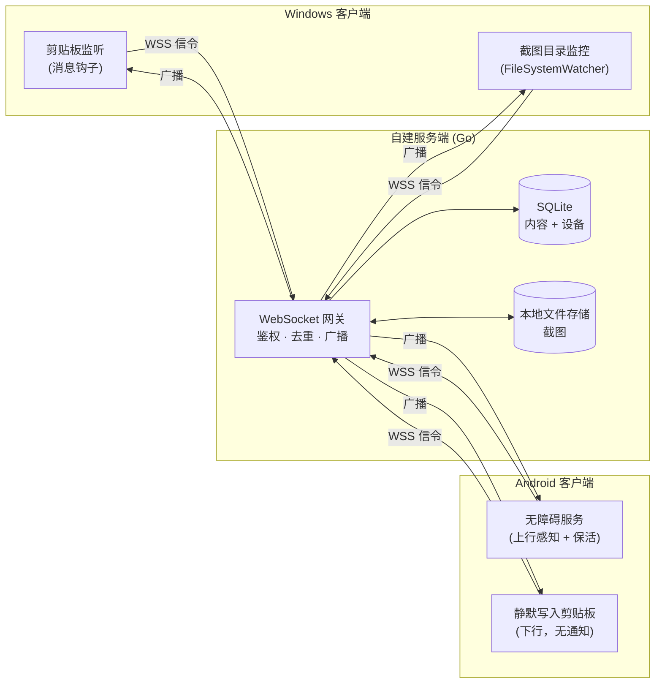
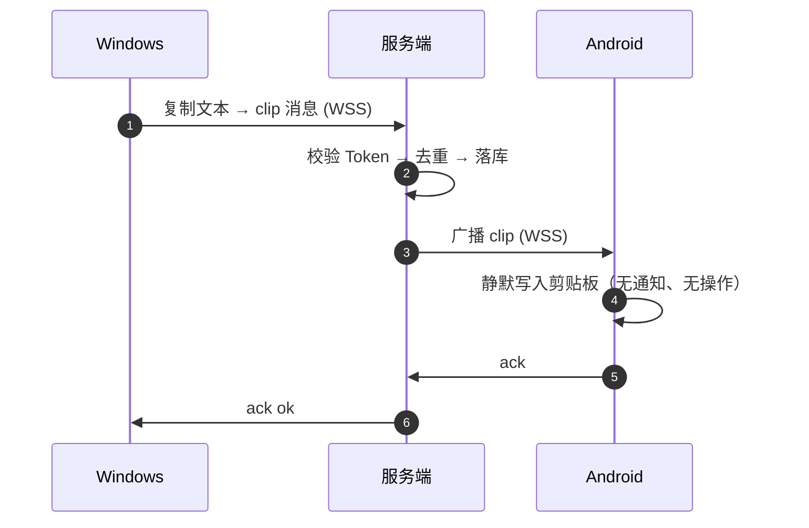
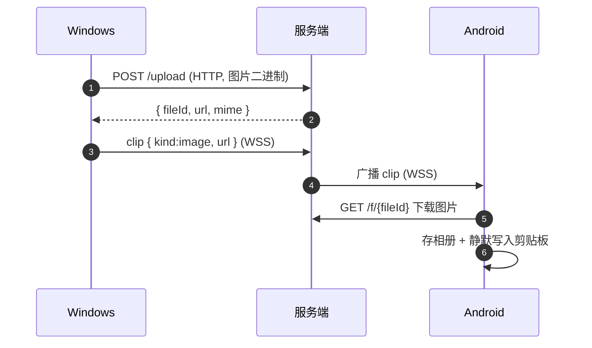

> [!IMPORTANT]
> **本项目由 AI 生成 · This project was generated by AI.**

# ClipBridge

**跨端剪贴板 / 截图同步，自建服务端，数据全掌控。**

在任意一台设备上复制一段文字、截一张图，它都会**自动、实时**出现在你所有其他已配对的设备上 —— 电脑、手机、平板都一样，全程无需手动点击"发送"。

<div align="center">

**Go + WebSocket + SQLite** · **C# / .NET 8** · **Kotlin / Compose**

**当前版本 v1.0.0** — [本版改动](CHANGELOG.md#v100-改动内容2026-10-25) · [下载产物](../../releases/latest)

**中文** | [English](README.en.md)

</div>

---

## 目录

- [快速开始](#快速开始) —— 一条 `docker run` 就跑起来
  - [服务端](#服务端一条-docker-run) · [客户端](#客户端)
- [为什么需要它](#为什么需要它) —— 它解决什么问题
- [核心原理](#核心原理) —— 怎么工作、为什么这么设计
- [特性](#特性) · [平台能力](#平台能力)
- [版本与下载](#版本与下载) —— 当前版本与产物下载 · [更新日志](CHANGELOG.md)
- [目录结构](#目录结构) · [文档](#文档)
- [安全提示](#安全提示) · [开源协议](#开源协议)

---

## 快速开始

### 服务端（一条 docker run）

镜像已发布在 GHCR 上（**公开，无需登录**，含 `amd64` + `arm64` 双架构）——
**不用 clone 仓库，也不用本地构建**，拉下来直接跑。

需要设置的配置就下面这几项：

| 变量 | 填什么 |
| --- | --- |
| `CLIPBRIDGE_SERVER_NAME` | 你的域名，如 `nas.example.com` |
| `CLIPBRIDGE_PUBLIC_BASE_URL` | `https://nas.example.com:8443`，端口要和 `-p` 一致 |
| `CLIPBRIDGE_JWT_SECRET` | 一串随机字符（**生成方法见下**） |
| `CLIPBRIDGE_ACME_DOMAIN` | 你的域名（申请证书用） |
| `CLIPBRIDGE_ACME_EMAIL` | 你的邮箱 |
| `CF_Token` | Cloudflare API Token（**获取方法见下**） |
| `CLIPBRIDGE_PAIR_CODE` | 自己定一个 8 位数字，多台设备配对时都填它 |

**签名密钥 `CLIPBRIDGE_JWT_SECRET` 怎么来**：一串随机字符，用来给登录令牌签名。
**定好之后别再改** —— 改了的话，所有已配对的设备都会掉线、需要重新配对。
生成方法：打开终端（Windows 在开始菜单搜「PowerShell」，macOS 搜「终端」，NAS 用 SSH 登录），
执行下面「对应你系统」的那一行，会得到一串 64 位的字符：

- macOS / Linux / NAS → `openssl rand -hex 32`
- Windows PowerShell → `-join ((1..64) | ForEach-Object { '{0:x}' -f (Get-Random -Maximum 16) })`

**Cloudflare Token `CF_Token` 怎么来**（用来自动申请证书）：

1. 登录 Cloudflare → 右上角头像 →「我的个人资料」→「API 令牌」
2.「创建令牌」→ 选「编辑区域 DNS」(Edit zone DNS) 这个模板
3. 区域资源选你自己的域名 → 创建 → 复制生成的那串令牌

> 换用阿里云 / 腾讯云等其它 DNS 的话，改传 `CLIPBRIDGE_ACME_DNS=dns_ali`（或 `dns_dp`），
> 并改用该服务商的凭据变量名。

**证书这三项都不填也能跑**，但只有明文 HTTP —— 而 Android 9+ 默认拒绝明文，手机端连不上。

把配置传进去有两种方式，**推荐第一种**：

#### 方式一（推荐）：

把下面命令里的域名和 `CHANGE_ME` 换成你自己的值，整条复制执行：

```bash
docker run -d --name clipbridge \
  --restart unless-stopped \
  -p 8443:8443 \
  -e CLIPBRIDGE_SERVER_NAME=nas.example.com \
  -e CLIPBRIDGE_PUBLIC_BASE_URL=https://nas.example.com:8443 \
  -e CLIPBRIDGE_JWT_SECRET=CHANGE_ME \
  -e CLIPBRIDGE_ACME_DOMAIN=nas.example.com \
  -e CLIPBRIDGE_ACME_EMAIL=you@example.com \
  -e CF_Token=CHANGE_ME \
  -e CLIPBRIDGE_PAIR_CODE=CHANGE_ME \
  -v clipbridge-data:/var/lib/clipbridge \
  ghcr.io/hemuxd/clipbridge:1.0.0

docker logs -f clipbridge     # 配对码打印在这里（多台设备可复用同一个）
```

#### 方式二：写进文件，用 `--env-file`

嫌上面那条命令太长、或想把配置留档复用，就存成一个 `clipbridge.env`：

```ini
# 你的域名（下面几处都换成它）
CLIPBRIDGE_SERVER_NAME=nas.example.com
CLIPBRIDGE_PUBLIC_BASE_URL=https://nas.example.com:8443

# 随机密钥（生成方法见上面的表格说明），定好后别改
CLIPBRIDGE_JWT_SECRET=CHANGE_ME

# 申请证书用
CLIPBRIDGE_ACME_DOMAIN=nas.example.com
CLIPBRIDGE_ACME_EMAIL=you@example.com
CF_Token=CHANGE_ME

# 自己定的 8 位数字
CLIPBRIDGE_PAIR_CODE=CHANGE_ME
```

```bash
docker run -d --name clipbridge \
  --restart unless-stopped \
  -p 8443:8443 \
  --env-file clipbridge.env \
  -v clipbridge-data:/var/lib/clipbridge \
  ghcr.io/hemuxd/clipbridge:1.0.0
```

> `#` 注释需要 Docker 25+ 才支持；更老的版本请先删掉注释行再用 `--env-file`。
> 另外这个文件里有密钥，**别提交到版本库**。

镜像里同时包含 **Go 二进制**与 **Nginx**，一个容器搞定，没有额外依赖。

**端口**：家庭宽带的 80 / 443 通常被运营商封锁，所以对外统一用 **8443**。
改端口时 `-p` 与 `CLIPBRIDGE_PUBLIC_BASE_URL` 里的端口号要同步改 ——
后者是客户端拿图片地址的前缀，不改的话图片打不开。

**换版本**：把镜像 tag `1.0.0` 换成目标版本即可（GHCR 上目前有 `1.0.0` 与 `sha-<提交>` 两类标签）。

**证书的另一种给法**：如果你已经用 acme.sh 在宿主机签好了证书，可以不开容器内 ACME ——
在上面那条 `docker run` 里加一个挂载，并把 ACME 那三项配置去掉：

```bash
-v /path/to/certs:/certs:ro     # 容器读 /certs/fullchain.pem 与 /certs/privkey.pem
```

续期后让 nginx 热加载即可：`docker exec clipbridge nginx -s reload`
（不要用 `docker restart` —— 会断开现有连接）。

> **为什么容器内 ACME 默认强制 IPv4**（`CLIPBRIDGE_ACME_IPV4_ONLY=1`）：
> Docker 默认 bridge 没有 IPv6 出口，容器解析到 AAAA 后会先试 IPv6 然后挂到超时；
> 而 acme.sh 对 POST 请求**不设响应超时**，一次丢包就永久卡死
> （实测 `finalize` 那步挂着数分钟不动，强制 IPv4 后连续 5 次全部成功）。
> 只有在你确认本机 IPv6 更稳时才设成 0。

> 想用 compose 集中管理配置？仓库里也带了编排文件（`deploy/docker/`），拉的是同一个镜像。

或本机直接跑（需 Go 1.22+）：

```bash
cd server
go run ./cmd/clipbridge -config config.example.yaml
```

### 客户端

- **Windows**：可直接下 [Releases](../../releases/latest) 里的 `clipbridge-windows-1.0.0-x64.zip`，
  解压后双击 `ClipBridge.exe` 启动（**单文件，自带 .NET 8 运行时**，不需要预装任何东西）。
  首次启动会弹出设置窗口，填服务端地址（`https://nas.example.com:8443`）+ 配对码即可，之后常驻托盘。
  自行构建：`cd clients/windows/src && dotnet publish -c Release -r win-x64 --self-contained true -p:PublishSingleFile=true -p:IncludeNativeLibrariesForSelfExtract=true`
  —— 最后那个参数才会把 WPF / VC 原生库也内嵌，得到真正的单文件。
- **Android**：可直接装 [Releases](../../releases/latest) 里的 `clipbridge-android-1.0.0.apk`；
  或自行 `cd clients/android && gradle assembleDebug`，产物在 `app/build/outputs/apk/debug/`。
  装好后打开 App → 填服务端地址（`https://nas.example.com:8443`）→ 配对 → **开启无障碍服务**，
  之后复制 / 截图即自动同步；截图同步需要在 App 内单独打开并授予相册读取权限。

> 完整的环境搭建、部署、排障见 `docs/开发指南.md`。

---

## 为什么需要它

市面上剪贴板同步工具不少，但大多有这些痛点：数据要过第三方服务器、只能局域网、只支持文本、或者需要手动点"发送"。ClipBridge 的定位是：

| 诉求 | ClipBridge 的做法 |
| --- | --- |
| 隐私自主 | 服务端**自建**，内容只经过你自己的服务器 |
| 统一通道 | 文本 + 截图走**同一条链路** |
| 无感自动 | Windows 端**零操作**，复制即同步 |
| 多设备 | 中心化转发，天然支持 N 台设备互相同步 |

---

## 核心原理

### 1. 架构：中心化转发（Hub-and-Spoke）

所有客户端**只和服务端建立一条 WebSocket 长连接**，客户端之间互不直连。服务端负责三件事：**鉴权 → 去重 → 广播**。



### 2. 数据流：文本同步



### 3. 数据流：图片同步

图片二进制**不走 WebSocket**，而是先 HTTP 上传拿到 URL，WebSocket 只传轻量元数据。这样大文件不会阻塞长连接。



### 4. 防回环：同步工具最容易翻车的地方

跨端同步有个经典死循环：`A 复制 → B 写入剪贴板 → B 又上报 → A 再写入 → 无限循环`，几秒就能打爆服务器。ClipBridge 用**三道防线**堵死它：

```
┌─────────────────────────────────────────────────────────┐
│ 第一道  客户端 HashCache                                │
│   远端内容写入本地前，先把它的 hash 记进缓存            │
│   本地监听事件命中该 hash → 判定"这是自己写回的"，跳过  │
├─────────────────────────────────────────────────────────┤
│ 第二道  服务端 hash 去重                                │
│   同一 hash 在保留窗口内已广播过 → 直接忽略，返回 2003  │
├─────────────────────────────────────────────────────────┤
│ 第三道  msgId 幂等                                      │
│   客户端重发同一 msgId → 命中唯一约束，视为重复          │
└─────────────────────────────────────────────────────────┘
```

关键细节：写剪贴板**之前**先登记 hash，而不是之后 —— 否则写入触发的监听事件来不及查到，回环就漏了。Windows 与 Android 两端都是这个顺序。

### 5. Android 的硬限制与取舍

这是整个项目唯一绕不过去的前提（详见 `docs/可行性报告.md`）：

> Android 10+ 起，后台应用**无法读取剪贴板**，且**没有任何权限可以申请**。
> AOSP `ClipboardService.clipboardAccessAllowed` 只对这几个身份放行读操作：
> 当前持有焦点的应用、默认输入法、SystemUI、ContentCapture 服务、Autofill 服务 ——
> **无障碍服务不在豁免名单里**。写入则不受限制（`OP_WRITE_CLIPBOARD` 直接放行）。

所以 ClipBridge 在 Android 上这样做：

| 方向 | 做法 | 可靠性 |
| --- | --- | --- |
| 下行（电脑 → 手机） | 收到即**静默写入系统剪贴板**，图片另存一份到相册 | ✅ 高（写入不受限） |
| 上行（手机 → 电脑） | 无障碍服务：先试读剪贴板；读不到就回退到"点复制前记下的选中文本" | ⚠️ 受厂商 ROM 影响 |
| 上行兜底 | 系统分享菜单「分享 → ClipBridge」，零权限零限制 | ✅ 100% |

上行之所以要做两路，是因为"读剪贴板"在很多机型上会被系统直接拒绝（返回 null），
此时只能靠无障碍事件还原用户复制的到底是什么。**两路都拿不到时宁可漏同步，
也不会把用户没复制的东西发出去。**

### 6. 只在"当前这一次操作"上生效

同步不是"把剪贴板里的东西都同步过去"，而是**只同步你此刻做的这一次复制/截图**：

- 客户端启动时把已存在于剪贴板 / 截图目录里的内容登记为历史，一律不上报
- 服务端默认**不做离线补推**（`limits.offline_replay_seconds: 0`）：
  设备离线期间攒下的内容直接丢弃，不会在它上线时一次性刷进来
- 需要容忍几秒网络抖动（重连空档里的内容不丢）时，把它设成 60~120 即可

---

## 特性

- ✅ 文本 / 图片**双向实时**同步
- ✅ 只同步**当前这一次**操作，历史内容不重发（补推窗口可配）
- ✅ Android 端**下行零提示**：内容静默写入剪贴板，不弹任何"收到内容"的提醒
- ✅ Android **后台保护**：划掉最近任务后连接不断（`stopWithTask=false`），开机自启 + 看门狗自动恢复
- ✅ 端到端加密（可选，AES-256-GCM，服务端只做密文盲转发）
- ✅ 敏感内容正则过滤 + 应用排除列表
- ✅ 历史记录自动过期（默认 7 天）
- ✅ **单镜像**部署：Go 二进制与 Nginx 打在同一个镜像里，一条命令起服务
- ✅ SQLite 零运维，纯 Go 驱动，可静态编译、可交叉编译
- ✅ 配对码支持多台设备复用（也可配置永久固定码）+ HMAC Token 鉴权 + 每设备限流

---

## 版本与下载

**当前版本 v1.0.0**（2026-10-25）。完整改动记录见 **[CHANGELOG.md](CHANGELOG.md)**。

产物见 [Releases 页面](../../releases/latest)：

| 产物 | 平台 | 说明 |
| --- | --- | --- |
| `clipbridge-server-1.0.0-linux-amd64.tar.gz` | Linux x86-64 | 静态二进制 + 配置样例 + 建表 SQL + systemd / nginx 配置 |
| `clipbridge-server-1.0.0-windows-amd64.zip` | Windows x86-64 | 同上，服务端本体 |
| `clipbridge-server-1.0.0-darwin-arm64.tar.gz` | macOS Apple Silicon | 同上 |
| `clipbridge-android-1.0.0.apk` | Android 8.0+ | 客户端安装包（debug 签名，可直接安装） |
| `clipbridge-windows-1.0.0-x64.zip` | Windows 10/11 x64 | 桌面客户端，解压后直接运行（单文件 exe，自带 .NET 8 运行时） |
| `SHA256SUMS.txt` | — | 上述文件的 SHA-256 校验和 |

**Docker 部署不需要下载二进制** —— 镜像已发布在 GHCR 上（公开，`amd64` + `arm64`）：
`ghcr.io/hemuxd/clipbridge:1.0.0`。用一条 `docker run` 拉取运行即可，
完整步骤（配置项、证书）见上面的[快速开始](#快速开始)。

---

## 平台能力

| 能力 | Windows | Android |
| --- | --- | --- |
| 监听剪贴板文本 | ✅ 系统原生通知，无感 | ⚠️ 后台受限，靠无障碍事件还原 |
| 捕获截图 | ✅ 剪贴板位图 + 目录监控 | ✅ 监听相册新增图片（需相册读取权限，默认关闭） |
| 写入剪贴板 | ✅ 直接写入 | ✅ 静默写入（写入不受后台限制） |
| 接收图片留档 | ✅ 另存到 `图片\ClipBridge`（可关） | ✅ 另存到相册 `Pictures/ClipBridge` |
| 常驻通知 | ✅ 无（托盘图标） | ⚠️ 后台保护需要一条静默通知（可在 App 内关闭）；下行内容本身不弹任何提示 |
| 可靠性兜底 | — | ✅ 系统分享菜单（零权限） |

---

## 目录结构

```
clipbridge/
├── server/                 # 服务端（Go）
│   ├── cmd/clipbridge/     # 入口
│   ├── internal/           # config / auth / hub / store / api / model
│   └── migrations/         # 建表 SQL
├── clients/
│   ├── windows/            # Windows 客户端（C# / .NET 8）
│   └── android/            # Android 客户端（Kotlin / Compose）
├── shared/protocol/        # 跨端协议（唯一基准）
├── deploy/
│   ├── docker/             # 单镜像部署（Go + Nginx）
│   ├── nginx/              # 宿主机 Nginx 方案（非 Docker 时用）
│   └── systemd/            # 开机自启
├── docs/                   # 可行性报告 · 开发指南 · 项目状态
└── tools/                  # 冒烟测试脚本
```

---

## 文档

| 文档 | 内容 |
| --- | --- |
| `docs/可行性报告.md` | 技术可行性、风险分析与 Android 权限限制详解 |
| `docs/开发指南.md` | 环境搭建、部署、联调、故障排查 |
| `docs/项目状态.md` | 完成度、已知待办、设计决策记录 |
| `shared/protocol/PROTOCOL.md` | 跨端通信协议（唯一基准） |

---

## 安全提示

- 全链路必须 TLS（Android 9+ 默认禁止明文 HTTP）
- 敏感内容建议配置正则黑名单，避免密码 / 验证码被同步
- 服务端历史记录支持自动过期，可手动一键清空

---

## 开源协议

本项目采用 **[GNU AGPL-3.0](LICENSE)** 许可，完整条款见 [LICENSE](LICENSE)。

你可以自由使用、修改、分发（包括商用），但有两项必须遵守：

- **衍生作品必须同样以 AGPL-3.0 开源** —— 不能改完闭源；
- **通过网络对外提供服务时，必须向使用者提供源码**（AGPL-3.0 第 13 条）——
  这是比 GPL 额外多出的一条，专门堵住"拿去做成在线服务却不开源"。

Copyright (C) 2026 HeMuxD
